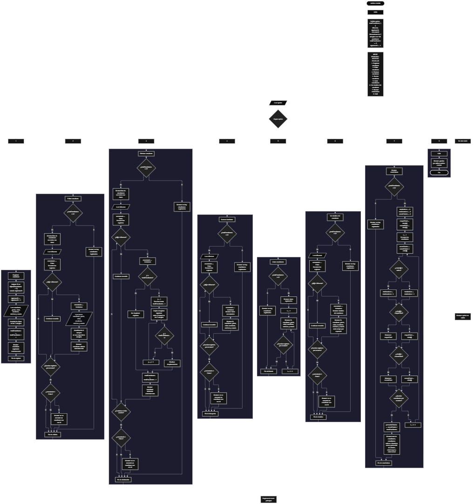

 

Este proyecto, llamado <b>archivo escolar</b>, fue desarrollado en <b>pseint</b> como un ejercicio práctico para fortalecer la lógica de programación mediante la creación de un sistema de gestión de estudiantes desde la consola. El programa cuenta con un menú principal de ocho opciones que permite <b>registrar, editar, eliminar, buscar, listar, consultar los detalles y mostrar estadísticas</b> de los estudiantes registrados. Cada estudiante almacena información como el nombre, el grado, la edad, el acudiente, el teléfono y el estado, utilizando siete arreglos paralelos de <b>100 posiciones declaradas</b> para organizar los datos durante la ejecución. Durante su desarrollo se aplicaron conceptos fundamentales de programación, como variables, arreglos, estructuras condicionales, ciclos repetitivos y estructuras de selección, además de procesos para buscar, modificar, eliminar y reorganizar registros. El programa también incorpora estadísticas relacionadas con las edades y los estados de los estudiantes. Este proyecto permite poner en práctica los conocimientos adquiridos en PSeInt y sirve como base para desarrollar sistemas de gestión escolar más avanzados utilizando otros lenguajes y tecnologías.

<h2 align="center">⚙️ Funcionamiento del menú principal</h2>

### ➕ Registrar estudiante

La opción <b>1) registrar estudiante</b> permite agregar un nuevo estudiante al archivo escolar. Al iniciar el registro, el programa asigna un identificador utilizando la variable <b>siguienteID</b>, que comienza en <b>1</b> y aumenta en uno después de cada asignación. El identificador se almacena en el arreglo <b>id</b>, en la posición correspondiente a <b>totalEstudiantes + 1</b>. Después, el programa solicita el <b>nombre del estudiante, el grado, la edad, el nombre del acudiente, el teléfono y el estado</b>. Cada dato se almacena en su respectivo arreglo, utilizando la misma posición para mantener relacionada la información de cada estudiante. Una vez ingresados todos los datos, la variable <b>totalEstudiantes</b> aumenta en uno y se muestra el mensaje <b>"estudiante registrado correctamente."</b>. En el código actual, el registro no comprueba si se ha alcanzado la capacidad de los arreglos ni valida los valores introducidos en los campos.

### ✏️ Editar estudiante

La opción <b>2) editar estudiante</b> permite modificar los datos de un estudiante previamente registrado. Primero, el programa comprueba si la variable <b>totalEstudiantes</b> es igual a <b>0</b>. Si no existen registros, muestra el mensaje <b>"no hay estudiantes registrados."</b>. En caso contrario, presenta una lista con el identificador, el nombre, el grado, la edad, el acudiente, el teléfono y el estado de cada estudiante. Después, solicita el identificador del estudiante que se desea editar mediante la variable <b>idBuscar</b> e inicializa la variable lógica <b>encontrado</b> con el valor <b>falso</b>. A continuación, utiliza un ciclo <b>para</b> para recorrer los registros y comparar cada identificador con el valor introducido. Cuando encuentra una coincidencia, cambia <b>encontrado</b> a <b>verdadero</b> y solicita los nuevos valores del nombre, el grado, la edad, el acudiente, el teléfono y el estado, actualizando los arreglos correspondientes. Finalmente, muestra el mensaje <b>"estudiante editado correctamente."</b>. Si termina el recorrido sin encontrar el identificador solicitado, presenta el mensaje <b>"no se encontró un estudiante con ese id."</b>.

### 🗑️ Eliminar estudiante

La opción <b>3) eliminar estudiante</b> permite eliminar un registro utilizando el identificador del estudiante. Primero, el programa comprueba si existen estudiantes registrados. Si <b>totalEstudiantes</b> es igual a <b>0</b>, muestra el mensaje <b>"no hay estudiantes registrados."</b>. De lo contrario, presenta una lista con los datos de los estudiantes y solicita el identificador que se desea eliminar. Después, inicializa <b>encontrado</b> con el valor <b>falso</b> y recorre los registros mediante un ciclo <b>para</b>. Cuando encuentra una coincidencia, cambia la variable a <b>verdadero</b>. Si el registro no ocupa la última posición activa, utiliza otro ciclo <b>para</b>, controlado por la variable <b>j</b>, para desplazar una posición hacia la izquierda los datos posteriores en los siete arreglos: <b>id, estudiante, grado, edad, acudiente, telefono y estado</b>. A continuación, disminuye <b>totalEstudiantes</b> en uno y muestra el mensaje <b>"estudiante eliminado correctamente."</b>. Si el identificador no se encuentra, presenta el mensaje <b>"no se encontró un estudiante con ese id."</b>. El código no limpia explícitamente la última posición después del desplazamiento, sino que reduce el total de registros activos.

### 🔎 Buscar estudiante

La opción <b>4) buscar estudiante</b> permite localizar a un estudiante mediante su identificador. Primero, comprueba si existen registros almacenados. Si no hay estudiantes, muestra el mensaje <b>"no hay estudiantes registrados."</b>. En caso contrario, solicita el identificador mediante la variable <b>idBuscar</b> e inicializa <b>encontrado</b> con el valor <b>falso</b>. Después, utiliza un ciclo <b>para</b> para recorrer las posiciones ocupadas y comparar los valores del arreglo <b>id</b> con el identificador introducido. Cuando encuentra una coincidencia, cambia la variable lógica a <b>verdadero</b>, muestra el mensaje <b>"datos encontrados"</b> y presenta el identificador, el nombre, el grado, la edad, el acudiente, el teléfono y el estado del estudiante. Si finaliza el recorrido sin encontrar coincidencias, muestra el mensaje <b>"no se encontró un estudiante con ese id."</b>. La búsqueda utiliza el identificador como criterio de consulta.

### 📋 Listar estudiantes

La opción <b>5) listar estudiantes</b> permite visualizar todos los estudiantes registrados en el sistema. Antes de mostrar la información, el programa comprueba si la variable <b>totalEstudiantes</b> es igual a <b>0</b>. Si no existen registros, presenta el mensaje <b>"no hay estudiantes registrados."</b>. Si hay estudiantes disponibles, muestra el encabezado <b>"datos registrados"</b> y utiliza un ciclo <b>para</b> para recorrer los arreglos desde la primera posición hasta el total de estudiantes registrados. Durante cada repetición, presenta el identificador, el nombre, el grado, la edad, el acudiente, el teléfono y el estado de cada estudiante en una misma línea. Esta función facilita consultar todos los registros activos sin necesidad de realizar búsquedas individuales.

### 📄 Ver detalles del estudiante

La opción <b>6) ver detalles del estudiante</b> permite consultar de forma individual toda la información de un estudiante específico. Primero, el programa comprueba si existen estudiantes registrados. Si no hay registros, muestra el mensaje <b>"no hay estudiantes registrados."</b>. En caso contrario, solicita el identificador del estudiante mediante la variable <b>idBuscar</b> e inicializa <b>encontrado</b> con el valor <b>falso</b>. Después, recorre los registros mediante un ciclo <b>para</b> y compara cada identificador con el valor introducido. Si encuentra una coincidencia, cambia la variable a <b>verdadero</b>, muestra el encabezado <b>"detalles del estudiante"</b> y presenta cada campo por separado: <b>id, estudiante, grado, edad, acudiente, telefono y estado</b>. Si no encuentra el identificador solicitado, presenta el mensaje <b>"no se encontró un estudiante con ese id."</b>. Esta opción facilita consultar la información de un estudiante de manera detallada y organizada.

### 📊 Mostrar estadísticas

La opción <b>7) mostrar estadísticas</b> permite obtener un resumen general de los estudiantes registrados. Primero, el programa comprueba si existen registros. Si <b>totalEstudiantes</b> es igual a <b>0</b>, muestra el mensaje <b>"no hay estudiantes registrados."</b>. En caso contrario, inicializa los contadores <b>totalActivos</b> y <b>totalInactivos</b>, así como el acumulador <b>sumaEdades</b>, con el valor <b>0</b>. También establece <b>mayorEdad</b> y <b>menorEdad</b> tomando como referencia la edad del primer estudiante, almacenada en <b>edad[1]</b>. Después, recorre los registros con un ciclo <b>para</b>, acumula las edades y comprueba el estado de cada estudiante. Si <b>estado[i] = "activo"</b>, aumenta el contador de estudiantes activos; en caso contrario, aumenta el contador de estudiantes inactivos. Durante el mismo recorrido, compara cada edad con los valores mayor y menor para actualizar las edades extremas cuando corresponda. Al finalizar, calcula el promedio mediante <b>sumaEdades / totalEstudiantes</b> y presenta el total de estudiantes, los activos, los inactivos, la suma y el promedio de las edades, la edad mayor y la edad menor. Esta operación permite consultar estadísticas generales a partir de los registros almacenados.

### 🚪 Salir del menú principal

La opción <b>8) salir</b> permite finalizar el uso del archivo escolar. Cuando el usuario selecciona esta opción, el programa muestra el mensaje <b>"gracias por utilizar archivo escolar."</b>. El menú principal se encuentra dentro de una estructura repetitiva <b>repetir ... hasta que</b>, cuya condición final es <b>opcion = 8</b>. Por lo tanto, después de seleccionar la opción 8, la condición se cumple y el ciclo termina. Si el usuario introduce un valor que no corresponde a ninguna de las opciones definidas, el bloque <b>de otro modo</b> muestra el mensaje <b>"opcion no valida."</b> y el menú vuelve a presentarse mientras la condición de salida no se cumpla.

<h2 align="center">🧠 Temas aplicados en el proyecto</h2>

### 📦 Variables

En este proyecto se utilizan variables para controlar la opción seleccionada en el menú, contar los estudiantes registrados, asignar identificadores, recorrer los arreglos, buscar registros y calcular estadísticas. Cada variable cumple una función específica dentro de las operaciones de administración escolar.

🔢 **Opcion:** Almacena la opción seleccionada por el usuario en el menú principal.

📊 **TotalEstudiantes:** Controla la cantidad de estudiantes registrados actualmente.

🆔 **SiguienteID:** Almacena el próximo identificador que se asignará al registrar un estudiante.

🔎 **IdBuscar:** Guarda el identificador introducido por el usuario para localizar un estudiante.

🔄 **I:** Funciona como contador en los ciclos utilizados para recorrer los arreglos y acceder a los registros.

🔁 **J:** Controla el recorrido utilizado para desplazar los datos durante la eliminación de un estudiante.

✅ **Encontrado:** Variable lógica que indica si se encontró el identificador solicitado durante las operaciones de edición, eliminación, búsqueda o consulta de detalles.

📈 **TotalActivos:** Cuenta los estudiantes cuyo estado es exactamente igual a <b>"activo"</b>.

📉 **TotalInactivos:** Cuenta los estudiantes cuyo estado no es igual a <b>"activo"</b>.

➕ **SumaEdades:** Acumula las edades de todos los estudiantes registrados.

📊 **PromedioEdades:** Almacena el resultado de dividir la suma de las edades entre el total de estudiantes.

🔺 **MayorEdad:** Guarda la mayor edad encontrada durante el recorrido de los registros.

🔻 **MenorEdad:** Guarda la menor edad encontrada durante el recorrido de los registros.

### 🗃️ Arreglos

En este proyecto se utilizan siete arreglos paralelos con una capacidad declarada de <b>100 posiciones</b> cada uno. Todos se relacionan mediante el mismo índice, de modo que los datos almacenados en una posición corresponden al mismo estudiante. Por ejemplo, la información del estudiante ubicado en la primera posición se distribuye entre <b>id[1], estudiante[1], grado[1], edad[1], acudiente[1], telefono[1] y estado[1]</b>. Esta organización permite registrar, modificar, buscar, listar, consultar y eliminar los datos de manera coordinada.

🆔 **Id[100]:** Almacena los identificadores numéricos de los estudiantes.

📝 **Estudiante[100]:** Almacena los nombres de los estudiantes.

🎓 **Grado[100]:** Almacena el grado escolar de cada estudiante.

🎂 **Edad[100]:** Almacena las edades de los estudiantes.

👨‍👩‍👧 **Acudiente[100]:** Almacena los nombres de los acudientes.

📞 **Telefono[100]:** Almacena los teléfonos de contacto.

📌 **Estado[100]:** Almacena el estado registrado para cada estudiante.

### 🔀 Estructuras condicionales

En este proyecto se utilizan las estructuras <b>si</b> y <b>sino</b> para comprobar si existen estudiantes registrados antes de realizar determinadas operaciones, verificar si un identificador coincide con un registro, determinar si se encontró un estudiante y decidir qué datos deben actualizarse o mostrarse. También se utilizan condiciones para desplazar los registros durante la eliminación y para clasificar a los estudiantes según su estado. En las estadísticas, las comparaciones permiten determinar las edades mayor y menor. Estas estructuras hacen posible que el programa responda de manera diferente según los datos almacenados y el resultado de cada comprobación.

### 🔄 Estructuras repetitivas

En este proyecto se utilizan los ciclos <b>para</b> y <b>repetir ... hasta que</b>. Los ciclos <b>para</b> permiten recorrer los arreglos para mostrar los estudiantes, buscar identificadores, editar datos, obtener detalles y calcular estadísticas. Durante la eliminación, un ciclo adicional desplaza los valores de los arreglos para mantener organizados los registros activos. Por otro lado, el ciclo <b>repetir ... hasta que</b> mantiene en funcionamiento el menú principal hasta que el usuario selecciona la opción <b>8</b>. Gracias a estas estructuras, el programa puede procesar varios estudiantes y ejecutar diferentes operaciones durante una misma sesión.

### 🎯 Estructura según

La estructura <b>segun</b> evalúa el valor almacenado en la variable <b>opcion</b> y ejecuta el bloque de instrucciones correspondiente. Cada caso representa una operación del sistema: <b>registrar, editar, eliminar, buscar, listar, ver detalles, mostrar estadísticas o salir</b>. Además, el bloque <b>de otro modo</b> permite mostrar el mensaje <b>"opcion no valida."</b> cuando el valor introducido no coincide con ninguna de las opciones disponibles. Esta estructura organiza las operaciones del menú y facilita la lectura del algoritmo.

### 🔢 Dimensionamiento de arreglos

El programa utiliza la instrucción <b>dimension</b> para declarar siete arreglos de <b>100 posiciones</b>. Cada arreglo almacena un campo diferente de la información de los estudiantes, mientras que la variable <b>totalEstudiantes</b> permite controlar cuántos registros se consideran activos durante la ejecución. Las operaciones de consulta y procesamiento recorren las posiciones comprendidas entre <b>1</b> y <b>totalEstudiantes</b>. Sin embargo, aunque los arreglos tienen 100 posiciones declaradas, el código actual no comprueba si se ha alcanzado esa capacidad antes de registrar otro estudiante.

### 🔄 Reorganización de registros

Cuando se elimina un estudiante que no se encuentra en la última posición activa, el programa utiliza el ciclo <b>para</b> controlado por la variable <b>j</b> para desplazar hacia la izquierda los datos de los estudiantes posteriores. En cada repetición, copia el valor de la posición siguiente sobre la posición actual en los siete arreglos: <b>id, estudiante, grado, edad, acudiente, telefono y estado</b>. Después, disminuye <b>totalEstudiantes</b> en uno. Este procedimiento permite conservar juntos los datos de cada estudiante y mantener consecutivas las posiciones consideradas activas. El algoritmo no limpia explícitamente los valores que quedan en la última posición después de la eliminación; estos dejan de formar parte de los registros activos porque el total disminuye.

<h2 align="center">¿Cómo se implementaron las operaciones crud en el proyecto?</h2>

Las operaciones <b>crud</b> se implementaron mediante las opciones del menú principal para administrar los estudiantes registrados. La operación <b>crear</b> corresponde a <b>registrar estudiante</b>, donde se asigna un identificador y se almacenan los datos del nuevo registro. La operación <b>leer</b> se realiza mediante las opciones <b>buscar estudiante, listar estudiantes y ver detalles del estudiante</b>, que permiten consultar la información almacenada. La operación <b>actualizar</b> corresponde a <b>editar estudiante</b>, donde se modifican los campos de un registro existente. Por último, la operación <b>eliminar</b> corresponde a <b>eliminar estudiante</b>, que retira un registro de la lista activa y desplaza los datos posteriores para reorganizar los arreglos. Estas operaciones utilizan variables, arreglos, condicionales y ciclos para gestionar la información durante la ejecución del programa.

<h2 align="center">Diagrama de flujo del proyecto</h2>

<h2 align="center">🛡️ Validaciones del programa</h2>

### 📭 No existen estudiantes registrados

Esta comprobación se utiliza en las opciones de <b>editar, eliminar, buscar, listar, ver detalles y mostrar estadísticas</b>. Antes de realizar estas operaciones, el programa comprueba si <b>totalEstudiantes</b> es igual a <b>0</b>. Si no hay registros, muestra el mensaje <b>"no hay estudiantes registrados."</b> y no ejecuta el procesamiento que depende de los datos almacenados. Esta comprobación permite manejar el caso en el que se intenta consultar o administrar un archivo escolar vacío.

### ❌ Estudiante no encontrado

Esta comprobación se utiliza en las operaciones de <b>editar, eliminar, buscar y ver detalles</b>. El programa inicializa la variable lógica <b>encontrado</b> con el valor <b>falso</b> y recorre los identificadores almacenados en el arreglo <b>id</b>. Cuando encuentra una coincidencia con <b>idBuscar</b>, cambia la variable a <b>verdadero</b> y ejecuta la operación correspondiente. Si finaliza el recorrido y la variable continúa siendo <b>falso</b>, muestra el mensaje <b>"no se encontró un estudiante con ese id."</b>. De esta manera, el programa informa cuando el identificador introducido no corresponde a un estudiante registrado.

### 📌 Clasificación por estado

En la opción de estadísticas, el programa comprueba si el contenido de <b>estado[i]</b> es exactamente igual a <b>"activo"</b>. Si la condición se cumple, incrementa <b>totalActivos</b>; de lo contrario, incrementa <b>totalInactivos</b>. El código no comprueba que los estados distintos de <b>"activo"</b> sean necesariamente <b>"inactivo"</b>, ni valida las mayúsculas, los espacios o los valores introducidos. Por tanto, cualquier otro contenido se contabiliza como inactivo durante el cálculo de las estadísticas.

### ⚠️ Capacidad de los arreglos

Los siete arreglos se declaran con <b>100 posiciones</b>, pero el procedimiento de registro no incluye una condición que compruebe si <b>totalEstudiantes</b> ha alcanzado ese límite. El programa utiliza la posición <b>totalEstudiantes + 1</b> para almacenar los nuevos datos y aumenta el contador al terminar el registro. Por esta razón, la capacidad de los arreglos está declarada, pero no existe una validación explícita que impida intentar registrar más de 100 estudiantes.

### 🔢 Datos introducidos por el usuario

El programa solicita el nombre del estudiante, el grado, la edad, el acudiente, el teléfono y el estado durante el registro y la edición. Sin embargo, el código actual no incluye comprobaciones para validar el contenido de estos campos, verificar que la edad sea positiva, exigir un formato específico para el teléfono o restringir el estado a determinados valores. Las operaciones trabajan con los datos que introduce el usuario y los almacenan en los arreglos correspondientes.

### ⚠️ Opción inválida

La estructura <b>segun</b> incluye el bloque <b>de otro modo</b>, que muestra el mensaje <b>"opcion no valida."</b> cuando el usuario introduce un valor diferente de las opciones definidas entre <b>1</b> y <b>8</b>. Esta respuesta permite informar que la selección no corresponde a ninguna operación disponible. El menú vuelve a mostrarse mientras la condición de salida <b>opcion = 8</b> no se cumpla.

<h2 align="center">🎯 Objetivo del proyecto</h2>

El objetivo principal de este proyecto es fortalecer la <b>lógica de programación</b> mediante el desarrollo de un sistema de gestión escolar en <b>pseint</b>. A través de su construcción se busca aplicar los conocimientos adquiridos sobre variables, arreglos, estructuras condicionales, ciclos repetitivos y estructuras de selección, integrándolos para resolver un problema de administración de estudiantes de manera organizada. Además, el proyecto permite comprender cómo registrar, consultar, modificar y eliminar información, así como obtener estadísticas a partir de los datos almacenados en una aplicación de consola. De esta forma, se establece una base para desarrollar sistemas de gestión escolar más completos utilizando otros lenguajes y tecnologías.

